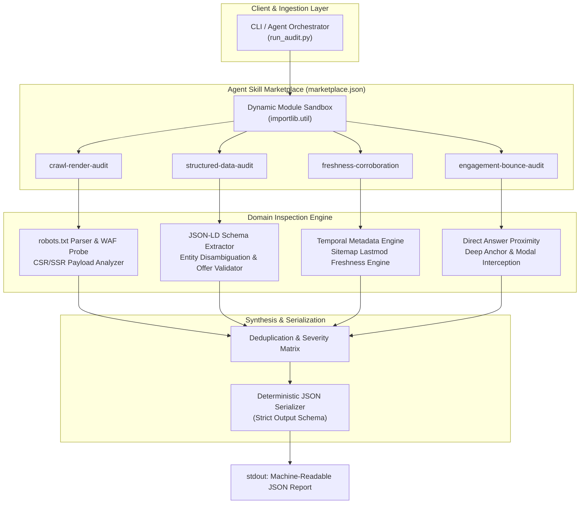
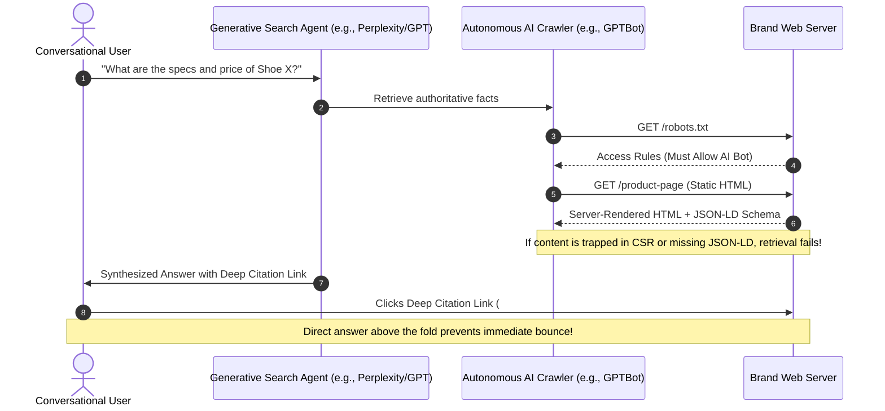

# System Architecture & Technical Design

## 1. Architectural Vision & Scope
The **Brand AI-Readiness Audit Marketplace** is an enterprise-grade auditing platform designed to evaluate any web property for **Generative Engine Optimization (GEO)** and **On-Site Context Retention**.

The system adheres to the [agentskills.io](https://agentskills.io) open standard, decomposing the audit workflow into isolated, single-responsibility skill units orchestrated by a single designated entrypoint.

---

## 2. Theoretical Foundations: The GEO Retrieval Pipeline

Modern generative search engines (ChatGPT Search, Perplexity, Google Gemini) operate via Retrieval-Augmented Generation (RAG) pipelines that depend on machine-readable semantic signals rather than classical keyword links:

---

## 3. Component Architecture & Layered Design

### 3.1. Manifest Specification (`marketplace.json`)
The manifest registers all skills, establishing metadata, licensing (Apache-2.0), relative file paths, and declaring `audit-orchestrator` with `entrypoint: true`.

### 3.2. Orchestration Layer (`skills/audit-orchestrator/scripts/run_audit.py`)
- **Isolation:** Loads each sub-skill independently without modifying global namespace.
- **Resilience:** Sandboxes sub-skill execution with per-skill try/except blocks so that network timeouts or malformed markup in one skill never crashes the full audit.
- **Normalization:** Normalizes finding severity (`critical`, `high`, `medium`), ensures deterministic sequential IDs (`F-001`, `F-002`, ...), and verifies JSON compliance.

### 3.3. Specialized Auditing Skills
1. **`crawl-render-audit`**:
   - `robots.txt` multi-agent parser (12 known AI crawlers + wildcard matching).
   - WAF bot-challenge detector (HTTP 401/403/429 checks).
   - Client-side rendering vs SSR analyzer (empty SPA container check `#root`, `#app`, `#__next` + script byte payload).
2. **`structured-data-audit`**:
   - JSON-LD syntax and `@graph` flattening engine.
   - Core Schema.org entity coverage (`Product`, `Offer`, `Organization`, `FAQPage`, `Article`).
   - Mandatory commercial attribute validation (`price`, `priceCurrency`, `availability`).
   - Entity disambiguation verification (`sameAs` links to authoritative knowledge bases).
3. **`freshness-corroboration`**:
   - Temporal metadata scanner (`dateModified`, `article:modified_time`, `Last-Modified` headers).
   - XML sitemap discovery and `<lastmod>` staleness evaluator (>12 months).
   - Stale copyright year detector.
   - Self-referential canonical URL validator.
4. **`engagement-bounce-audit`**:
   - Direct-Answer-First layout inspector in top 20% DOM (<80 words following H1).
   - Deep-link citation anchor scanner (`id` attributes on sections/subheadings).
   - Intrusive modal and blocking overlay detector.
   - Text-to-HTML code ratio evaluator (<6% threshold).
